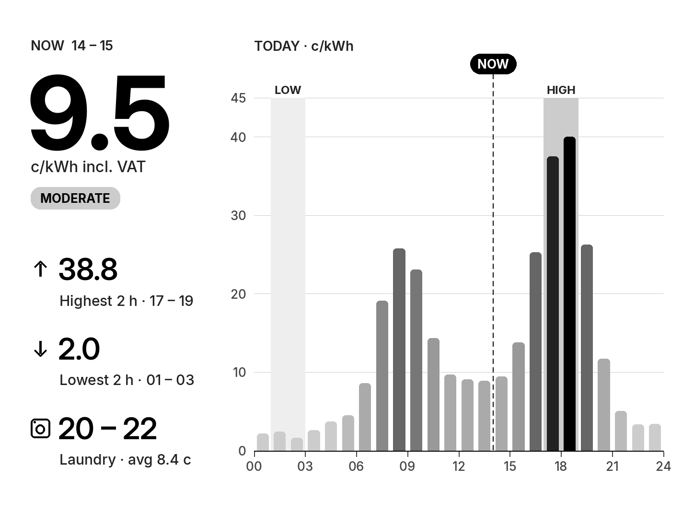
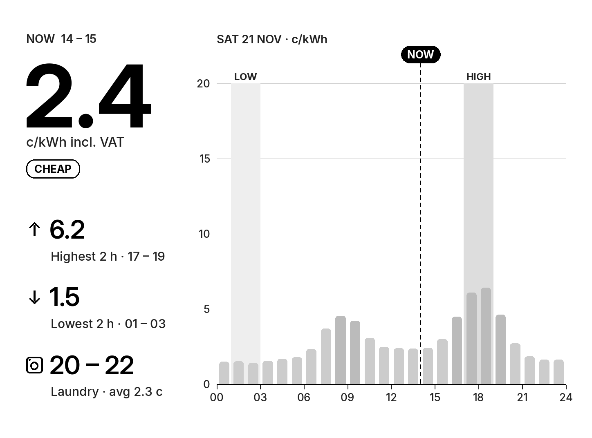

# kindle-spot-price

Show today's Finnish electricity spot prices on the lock screen of a jailbroken
Kindle Paperwhite 3, while still reading normally in the stock Kindle reader.

<p align="center">
  <br>
  
</p>

<sub>Previews use made-up sample prices: an ordinary day and a cheap day. The Kindle is used in landscape.</sub>

[中文说明](docs/README.zh-CN.md)

## How it works

```
 spot-hinta.fi  ──►  GitHub Actions  ──►  GitHub Pages  ──►  Kindle lock screen
 (Nord Pool FI)      renders 48 hourly     hosts the         downloads once a day,
                     e-ink images/day      images            switches every hour offline
```

- **Cloud:** after tomorrow's prices are published (~14:00), a GitHub Actions job renders one
  image per hour for today and tomorrow and publishes them on GitHub Pages. Free, no server.
- **Kindle:** a scriptlet covers the stock lock-screen folder with a bind mount (the system
  partition is never modified). While the Kindle is awake, a small updater downloads new images
  in the evening and shows the right one for the current hour, without needing Wi-Fi.

Details: [docs/how-it-works.md](docs/how-it-works.md)

## What it shows

The image is drawn in landscape (Kindle turned with its top edge to the left):

- **Left – now:** the current hour's price in large type, a label (CHEAP < 8, MODERATE < 20,
  EXPENSIVE < 30, VERY EXPENSIVE), the highest and lowest 2-hour windows of the day, and the
  best laundry window: the cheapest 2 whole hours between 07 and 22 in the rest of the day
  (late in the evening it shows tomorrow's).
- **Right – today:** 24 hourly prices (average of the four 15-minute prices), c/kWh incl. VAT.
  - bar gray = absolute price, one level per 4 c/kWh, from light gray (< 4) to black (≥ 40)
  - y axis 0–20 on ordinary days; above 20 it grows to the next multiple of 5
  - **LOW / HIGH** bands mark the cheapest and most expensive 2 hours
  - a dashed line with a **NOW** label marks the start of the current hour

### Design notes

The layout went through several rounds of iteration. The ideas that shaped it:

- **One glance, two questions.** The left side answers *"should I use electricity now?"* (big number
  plus a CHEAP / EXPENSIVE label); the right side answers *"when today?"* (the chart).
  Everything else was cut.
- **Designed for a 16-level e-ink panel.** Every gray is a multiple of 17, so nothing is dithered.
  Bars have no outlines; the lightest bar is light gray instead of white, so even cheap hours
  stay visible on the white background.
- **Gray shows the absolute price, height shows the day's shape.** One gray level per 4 c/kWh
  means a cheap day stays light even when its bars fill the chart.
- **A stable scale.** 0–20 c/kWh on ordinary days, growing only on expensive days (inspired by
  Helen's app), so the chart looks the same from day to day and a tall chart itself means
  "expensive day".
- **Highlight instead of annotate.** The cheapest and most expensive 2 hours are background
  bands. LOW is always the lightest gray; HIGH is a few levels lighter than its own bars, so a
  band never hides the bars inside it. The current hour is a dashed line at its start.
- **Removed what didn't help:** legend, reference lines, average line, bar outlines, divider
  lines and pointer arrows. Each was tried and dropped when the screen read better without it.
- **Typography.** [Inter](https://rsms.me/inter/) and Inter Display in three sizes: hero
  number, values, small labels. Times are written as hour ranges (`17 – 19`), x-axis ticks sit
  on hour boundaries every 3 hours, and icons are centered on the digits' cap height.
- **Landscape** gives the 24 bars room to breathe. The image is drawn at 1448 × 1072 and rotated
  into the Kindle's portrait 1072 × 1448 lock-screen format.

### Update strategy

Prices are fixed a day ahead, so the work is split so that the Kindle almost never needs the
network:

1. **Render ahead (cloud):** every afternoon GitHub Actions renders one image per hour for
   today and tomorrow.
2. **Download once (Kindle, on Wi-Fi):** in the evening the Kindle fetches tomorrow's images
   and deletes yesterday's.
3. **Switch offline (Kindle):** at each full hour it copies the right image into the lock screen.
4. **Wake up while locked:** a hardware alarm wakes the sleeping Kindle at each full hour
   (07–22 by default, quiet at night), it redraws the lock screen in about a second and goes
   back to sleep. No Wi-Fi, no visible home screen.

| When (Finnish time) | What happens |
|---|---|
| hourly 14:23–21:23 | cloud renders today + tomorrow (one hour later in summer); GitHub may delay or skip some runs, one success is enough |
| after 18:00, Kindle on Wi-Fi | downloads tomorrow's images |
| every full hour, 07–22 | lock screen switches to the new hour, even while locked |
| 23:00–07:00 | no wake-ups (configurable in `sslive/config.txt`) |

Details, measurements and the one known limitation (the Kindle stays awake ~95 s per wake-up):
[docs/update-strategy.md](docs/update-strategy.md)

## Setup

### 1. Publish the image

1. Push this repository to GitHub.
2. **Settings → Pages → Build and deployment → Source: GitHub Actions**.
3. **Actions → Update price image → Run workflow**.
4. After a minute the site is at `https://<your-user>.github.io/kindle-spot-price/`
   (latest image: `kindle.png`, hourly images: `frames/`).

### 2. Kindle

Requirements: a jailbroken Kindle Paperwhite 3 (tested on firmware 5.16.2.1.1 with WinterBreak2).

Files in this repository:

```
kindle/
├── scriptlets/
│   ├── ss_on.sh      "Lockscreen ON / Refresh" - copy into the Kindle's documents/ folder
│   └── ss_off.sh     "Lockscreen OFF" - copy into the Kindle's documents/ folder
├── sslive/
│   ├── url.txt       your GitHub Pages address - copy into the Kindle's sslive/ folder
│   └── config.txt    hourly wake-up and quiet hours - copy into the Kindle's sslive/ folder
└── tools/
    ├── ss_diag.sh    optional read-only diagnostic, not needed for normal use
    ├── wake_diag.sh  optional: power events and RTC devices (read-only)
    └── wake_test.sh  optional: one-shot timed wake-up test
```

> **Copy the files, not the folders.** Dragging a folder named `documents` onto the Kindle
> makes Finder offer to *replace* the existing `documents` folder, which would delete your books.

#### Install

1. **Set your URL.** Open `kindle/sslive/url.txt` and replace `YOUR-USER` with your GitHub
   user name. Check the address in a browser first: `<your URL>frames/manifest.txt` should show
   a list of file names.
2. **Connect the Kindle** by USB. On a Mac it appears as `/Volumes/Kindle`.
3. **Copy the two scriptlets** into the Kindle's `documents` folder. In Finder, select
   `ss_on.sh` and `ss_off.sh` and drag them *into* `Kindle/documents`. If asked, replace the
   older versions (this replaces only these two files).
4. **Copy `url.txt` and `config.txt`** into the Kindle's `sslive` folder (create `sslive` in the
   Kindle root if it does not exist). `config.txt` sets the hourly wake-up and the quiet hours;
   without it the defaults (on, quiet 23–07) are used.

   Steps 3–4 in Terminal, from the repository folder (`-X` skips macOS metadata, which
   would otherwise create extra `._ss_on.sh` files on the Kindle):

   ```bash
   cp -X kindle/scriptlets/ss_on.sh kindle/scriptlets/ss_off.sh /Volumes/Kindle/documents/
   mkdir -p /Volumes/Kindle/sslive
   cp -X kindle/sslive/url.txt kindle/sslive/config.txt /Volumes/Kindle/sslive/
   dot_clean -m /Volumes/Kindle      # removes ._ files left by earlier Finder copies
   ```
5. **Eject** the Kindle in Finder before unplugging.
6. **Lock screen setting:** on the Kindle, turn **Display Cover** off, so the lock screen uses
   the built-in images.
7. **Start:** make sure Wi-Fi is connected, open the library and tap **Lockscreen ON / Refresh**.
   If an older version was running, tap **Lockscreen OFF** first.
   The screen shows e.g. `Lockscreen ON. Showing: 20261121-13.png`.

#### Check that it works

| Check | Expected |
|---|---|
| Press the power button | the price chart, current hour in the top-right corner |
| `sslive/log.txt` (over USB) | `download: 24 new, 0 failed` and `showing YYYYMMDD-HH.png` |
| Stay awake past a full hour, then lock | the corner shows the new hour |
| Lock before a full hour, unlock after it, lock again | the corner shows the new hour |
| Use the Kindle on Wi-Fi after 18:00 | log: another `download: 24 new` (tomorrow's images) |

If the screen says `Using current.png ...` or `ERROR: no image yet`, nothing could be
downloaded: check Wi-Fi and `url.txt`, and look at `sslive/log.txt`.

#### Everyday use

- Nothing to do: images are downloaded and switched automatically while the Kindle is awake.
- **After a reboot** the stock lock screen is back; tap **Lockscreen ON / Refresh** once.
- **Lockscreen OFF** restores the stock lock screen, stops the updater and cancels the hourly
  wake-up alarm.
- **Updating** to a new version of the scripts: repeat steps 3, 5 and 7.
- Tapping **Lockscreen ON / Refresh** again re-downloads all images (useful after the image design changed).
- **Uninstall:** tap **Lockscreen OFF**, delete `ss_on.sh`, `ss_off.sh` and the `sslive` folder.
  About 1.5 MB of downloaded images stays in `/var/local/sslive` on internal storage
  (harmless; it can be removed over SSH or kTerm).

#### Optional: diagnostic

`kindle/tools/ss_diag.sh` (shows up as **Screensaver Check**) only reads information: stock
screensaver files, available tools, screen size. Copy it into `documents`, run it, and read
`ss_diag/info.txt` over USB. Useful when something does not work or when trying another Kindle
model; not needed otherwise.

## Development

```bash
pip install -r requirements.txt
python -m pytest -q
python render/render.py --input tests/fixtures/sample-winter.json --now 2026-11-21T09:40 --out-dir out
# out/kindle.png, out/prices.json, out/frames/*.png + manifest.txt
```

Settings such as the gray step and laundry hours are constants at the top of
`render/render.py`. Environment variables: `KSP_LAYOUT=portrait` for the older portrait design,
`KSP_ROTATE=90` if your Kindle is held the other way round.

The landscape design uses [Inter](https://rsms.me/inter/) (SIL Open Font License), included in
`render/fonts/`.

## Roadmap

- [x] Pre-render hourly images; download once a day, switch hourly offline
- [x] Wake the Kindle every hour (07–22, quiet at night) while it sleeps and redraw from local images, no Wi-Fi – [details](docs/update-strategy.md)
- [ ] Shorten the ~95 s awake time after each timed wake-up
- [ ] Start automatically after a reboot
- [ ] Reuse `prices.json` on an ESP32-S3 + 7.5" e-ink desktop display
- [ ] Fallback data source

## Notes

- Prices are Nord Pool day-ahead prices for Finland incl. VAT, without your retailer's margin or
  transmission fees, from [spot-hinta.fi](https://spot-hinta.fi). Check their terms before heavy use.
- GitHub pauses scheduled workflows in repositories with no activity for 60 days; re-enable it
  from the Actions tab (GitHub sends an email).
- Jailbreaking is at your own risk. The lock-screen method here avoids writing to the system
  partition, but no warranty is given.
- The idea of fetching an image and showing it as the screensaver comes from the
  Kindle community's *Online Screensaver* extension; this project uses its own scripts.

## License

MIT, see [LICENSE](LICENSE).
