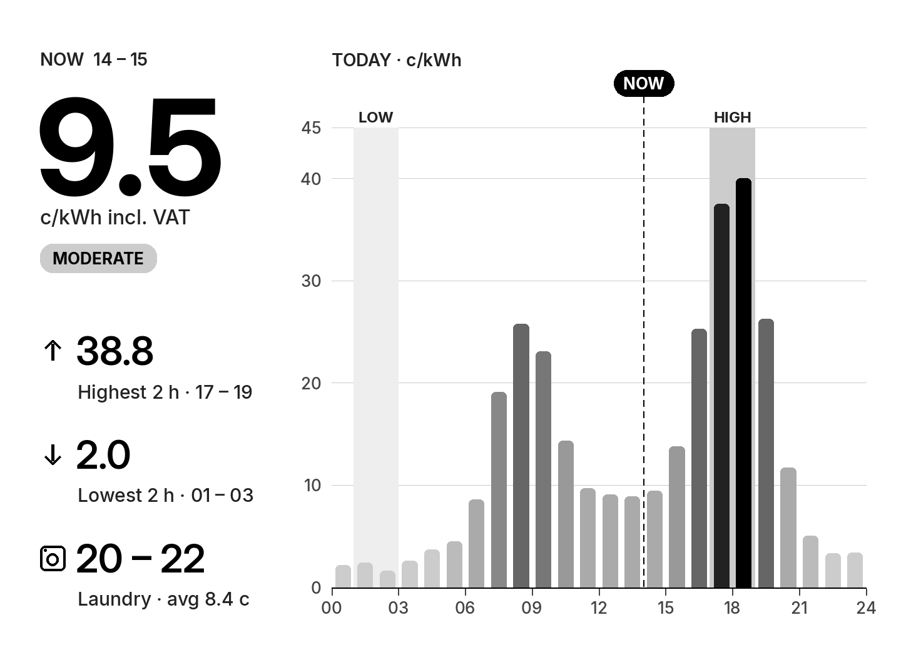

# kindle-spot-price 中文说明

在越狱的 Kindle Paperwhite 3 锁屏上显示芬兰当天的现货电价，原生阅读器照常使用。

<p align="center"></p>

## 图上有什么

图片上的文字是英文（High / Low / Best laundry 等），下面是各部分的含义。


- **今天 24 小时的电价柱状图**：每小时取 4 个 15 分钟价格的平均值，单位 c/kWh，含增值税
- **按价格分灰阶**：每 4c 一级，白色（< 4）到黑色（≥ 40）；虚线标出 8c（便宜）和 20c（贵）
- **当前小时**：柱子下方的三角形；右上角也写着这张图对应的小时，一眼能看出锁屏是不是旧的
- **最高价、最低价**的时段
- **最佳洗衣时段**：今天剩余时间里、7 点到 22 点之间最便宜的连续 2 小时；晚上已经没有合适时段时，改为显示明天的（明天的电价约 14 点公布）

价格是 Nord Pool 芬兰区现货价，含税，不含电力公司的加价和电网传输费。

## 原理

电价提前一天就确定了，所以图片可以全部预先画好。

1. **云端**：明天的电价约 14 点公布后，GitHub Actions 每天在 15、16、17 点（另加 20 点保险）运行，从 spot-hinta.fi 拉取电价，为今天和明天的**每个小时各画一张图**，发布到 GitHub Pages。不需要自己的服务器。（定时用的是 UTC 时间，夏令时期间会晚一小时。）
2. **Kindle**：脚本把内部存储里的一个文件夹"挂载"到系统锁屏图文件夹上，系统分区不做任何修改，重启后自动恢复原样。后台脚本只在 Kindle 醒着时运行：
   - 18 点以后 Wi-Fi 开着时，下载明天的图，同时删除前一天的图（一般一天一次，比如你晚上看书时）
   - 如果晚上没用 Kindle，第二天第一次联网唤醒时，发现当前小时没有图，会自动补下载
   - 每到整点，以及每次唤醒 Kindle 时，换上当前小时的图，这一步不需要联网

详细技术说明见 [how-it-works.md](how-it-works.md)（英文）。

## 安装

### 第一步：发布图片

1. 把这个仓库推送到 GitHub
2. 仓库 **Settings → Pages**，**Source** 选 **GitHub Actions**
3. **Actions → Update price image → Run workflow**，手动运行一次
4. 约一分钟后，网址是 `https://<你的用户名>.github.io/kindle-spot-price/`（最近一次生成的图 `kindle.png`，每小时的图在 `frames/` 里）

### 第二步：Kindle

前提：Kindle Paperwhite 3 已越狱（在固件 5.16.2.1.1、WinterBreak2 越狱上测试过）。

项目里的相关文件：

```
kindle/
├── scriptlets/
│   ├── ss_on.sh      Lockscreen ON（开启）  → 拷进 Kindle 的 documents 文件夹
│   └── ss_off.sh     Lockscreen OFF（关闭） → 拷进 Kindle 的 documents 文件夹
├── sslive/
│   └── url.txt       你的 GitHub Pages 网址 → 拷进 Kindle 的 sslive 文件夹
└── tools/
    └── ss_diag.sh    可选的只读检查脚本，正常使用不需要
```

> **只拷文件，不要拷文件夹。** 如果把一个叫 `documents` 的文件夹拖到 Kindle 上，Finder 会提示"替换"已有的 `documents` 文件夹，点了就会把你的书全部删掉。

#### 安装步骤

1. **填写网址**：打开项目里的 `kindle/sslive/url.txt`，把 `YOUR-USER` 换成你的 GitHub 用户名。以 `#` 开头的行是说明，会被忽略。改完先在浏览器里打开"你的网址 + `frames/manifest.txt`"，能看到一列文件名就说明网址对了。
2. **连接 Kindle**：USB 连上 Mac，Finder 里会出现 `Kindle`（路径是 `/Volumes/Kindle`）。
3. **拷贝两个脚本**：在 Finder 里同时选中 `ss_on.sh` 和 `ss_off.sh`，拖**进** Kindle 的 `documents` 文件夹里面。如果提示有同名文件，选"替换"，这只会替换这两个文件。
4. **拷贝 `url.txt`**：拖进 Kindle 根目录的 `sslive` 文件夹。如果还没有 `sslive`，先在 Kindle 根目录新建一个。

   第 3、4 步也可以在终端里完成（先 `cd` 到项目文件夹）。`-X` 表示不拷贝 macOS 的附加信息，否则 Kindle 上会多出 `._ss_on.sh` 这样的隐藏文件，可能在书库里显示成打不开的"书"：

   ```bash
   cp -X kindle/scriptlets/ss_on.sh kindle/scriptlets/ss_off.sh /Volumes/Kindle/documents/
   mkdir -p /Volumes/Kindle/sslive
   cp -X kindle/sslive/url.txt /Volumes/Kindle/sslive/
   dot_clean -m /Volumes/Kindle      # 清理之前用 Finder 拷贝时留下的 ._ 文件
   ```
5. **弹出 Kindle**：在 Finder 里点"推出"，再拔线。
6. **锁屏设置**：在 Kindle 设置里关闭 **显示封面**（Display Cover），让锁屏使用系统自带的图片。
7. **启动**：确认 Wi-Fi 已连接，在书库里点 **Lockscreen ON**。如果之前运行过旧版本，先点一次 **Lockscreen OFF**。屏幕上会显示类似 `Lockscreen ON. Showing: 20261121-13.png` 的信息。

#### 检查是否生效

| 检查方法 | 正常的结果 |
|---|---|
| 按电源键锁屏 | 显示电价图，右上角是当前小时 |
| 连 USB 打开 `sslive/log.txt` | 有 `download: 24 new, 0 failed` 和 `showing 年月日-小时.png` |
| 醒着跨过一个整点后锁屏 | 右上角变成新的小时 |
| 整点前锁屏，过了整点解锁，再锁屏 | 右上角变成新的小时 |
| 18 点后连着 Wi-Fi 用一下 Kindle | 日志里又多一行 `download: 24 new`（明天的图） |

如果屏幕上显示 `Using current.png ...` 或 `ERROR: no image yet`，说明没下载到图：检查 Wi-Fi 和 `url.txt`，再看 `sslive/log.txt` 里的错误信息。

#### 日常使用

- 不需要任何操作：Kindle 醒着时会自动下载和换图
- **重启后**会恢复成原来的锁屏，点一次 **Lockscreen ON** 即可
- **Lockscreen OFF**：恢复原来的锁屏，停止后台脚本
- **更新脚本到新版本**：重复安装步骤 3、5、7
- **卸载**：点 **Lockscreen OFF**，删掉 `ss_on.sh`、`ss_off.sh` 和 `sslive` 文件夹。内部存储的 `/var/local/sslive` 里会留下约 1.5 MB 已下载的图，不影响使用，想删可以通过 SSH 或 kTerm

#### 可选：检查脚本

`kindle/tools/ss_diag.sh`（在书库里显示为 **Screensaver Check**）只读取信息，不改任何东西：系统锁屏图片、可用的工具、屏幕分辨率等。拷进 `documents` 运行后，连 USB 查看 `ss_diag/info.txt`。出问题需要排查，或者想在其他型号的 Kindle 上用时才需要，平时不用装。

## 目前的限制

- Kindle 锁屏后会深度休眠，后台脚本也会暂停，所以锁屏显示的是**锁屏那个小时**的图，右上角的小时能看出是哪一张。
- 下一步计划：锁屏期间每小时自动醒几秒，用本地已有的图刷新屏幕，再睡回去，不需要开 Wi-Fi。

## 注意

- GitHub 的仓库如果 60 天没有任何活动，定时任务会被暂停，GitHub 会发邮件通知，到 Actions 页面重新启用即可。
- 越狱有风险，后果自负。本项目的锁屏方法不写入系统分区，但不做任何保证。
